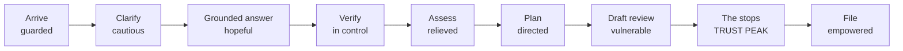

# LokAI — User Journey Map

> Repo: `D:\portfolio porjects\Lokaifm-main` (branch `feature/single-matter-guardrails`) · Documented 2026-09-16 from latest code + repo docs.
> **Basis & honesty note:** no user research exists. Journeys model the *intended* experience from `PRODUCT.md` (authored story: Priya), `docs/MOBILE_AI_SYSTEM.md` (composition law + screen intents), `docs/CASE-STUDY.md` (decision reasoning), and the status vocabulary's design philosophy ("a badge is a word a stressed person reads in passing"). Screen IDs per [04-information-architecture](04-information-architecture.md). Empathy quadrants: [03-empathy-maps](03-empathy-maps.md).

## Persona journeyed

**Primary: Priya** — a first-time user with a consumer-refund problem (damaged mixer grinder, ₹8,999, seller refused replacement in writing). Stressed, not legally literate, possibly more comfortable in Hindi/Marathi/Tamil than English, on a phone, afraid of being cheated twice (by the seller and by her own mistakes). Secondary: the reviewer persona (an evaluator/lawyer checking whether the system knows when to stop).

## Journey 1 — Priya: from "I've been cheated" to a filed complaint

| Stage | Priya does (screen) | Thinks (inferred) | Emotion | Pain point the design answers |
|---|---|---|---|---|
| 1. Arrive wary | Onboarding: purpose + language (LOK-M0) | "Another app that will sell my data or fake a lawyer?" | Guarded | Legal-app distrust; **answer:** prepared sign-in, "No network or device permission requested" audited from minute zero |
| 2. Blurt the problem | Types the mixer story (LOK-M1) | "I don't even know what this is legally." | Anxious, urgent | Forms and legalese; **answer:** a chat canvas asks one real question first (the clarify middle) |
| 3. Answer one question | Picks her purchase date (clarify turn) | "Okay, it's listening, not lecturing." | Cautiously engaged | Interrogations with 20 questions; **answer:** ONE clarify, routed to a better answer |
| 4. Get a grounded answer | Explain turn with sources + glossary taps (LOK-M1/D2) | "Is this real law or AI soup?" | Skeptical hope | Unverifiable AI claims; **answer:** three-zone explain, Direct/Related source coverage, CPA 2019 citations in place |
| 5. Verify her own facts | Confirm/correct the fact table (LOK-M3/M4) | "Wait — I said June 6th but was it?" | Self-doubt → control | AI confidently using wrong facts; **answer:** disputed facts flagged "Needs a check", corrections clear the draft |
| 6. Understand her standing | Assessment: claim ledger + risk in her words (LOK-M5) | "So do I have a case?" | Relief with honesty | Fake confidence; **answer:** "You can do this" / "A lawyer should check" — citizen words, never tier codes |
| 7. Get the plan | Ordered action steps (LOK-M6) | "What do I actually DO tomorrow?" | Directed | Advice without steps; **answer:** locked→current→done sequence with one CTA per stage |
| 8. Review the draft | Demand notice AI draft (LOK-M7) | "Did it put words in my mouth?" | Vulnerable | AI drafting *for* people; **answer:** draft blocked until plan approved; approval audited; facts corrections invalidate it |
| 9. The moments it stops | High-risk / out-of-scope states (LOK-M8) | "…it's refusing to risk my case." | Trust lands HERE | AI that never says no; **answer:** the 8 stops — refusal with reason + path, the journey's emotional peak in reverse: trust is *built by declining* |
| 10. File & track | Next actions + tracking banner | "I can actually finish this." | Empowered | Post-advice abandonment; **answer:** the matter absorbs artifacts — notice → exhibit → deadline tracking |

### Emotional curve (journey 1)

The counter-intuitive shape: **the trust peak is a refusal** — the stops at stage 9 do more for the relationship than any answer.

## Journey 2 — The stress case (when the matter outgrows the app)

₹6 lakh business loss, deadline tomorrow (high_risk scenario): Priya asks → LokAI **stops** — "Professional guidance recommended", no draft, routes to professional help. Designed emotional arc: panic → recognition that the system knows its limits → gratitude for the honesty. The companion case: criminal-fraud request → "outside LokAI's scope" → why + alternatives. Both exist so the reviewer sees the boundary behavior **before** trusting the compliant path.

## Journey 3 — The notice moment (founding-feature journey)

A BMC property-tax notice lands (real life interrupting): Priya photographs it → interpreted in her language inside chat (what it says / demands / by when) → facts extracted as chips → becomes an exhibit with a tracking deadline in her matter. Emotional arc: dread (official paper) → comprehension → control. Deep link evidence: `/mobile/notice?doc=bmc-property-tax&open=1`.

## Journey 4 — The reviewer's pass (secondary persona)

An evaluator opens `/dev` (every screen/state indexed), switches guardrail scenes from the drawer/chat, flips languages (?lang=hi/ta/mr), inspects specimens on bare canvas, reads the audit trail, and tries to make it misbehave. Success criterion (PRODUCT.md): complete the consumer story, trigger every guardrail, understand every stop, observe zero network/permission requests.

## Pain-point → design-answer index (quotable)

| Pain point | Design answer (evidence) |
|---|---|
| Legal AI that performs confidence | Three-zone explain + source coverage + glossary in place (`Turn.tsx`, responseTurns) |
| Being interrogated by forms | One clarify per conversation, then straight routing (`DemoContext` clarify middle) |
| AI using wrong facts confidently | Fact states + "Needs a check" + correction invalidates drafts (`statusVocabulary`, audit events) |
| Systems that never refuse | 8 stop kinds with reasons and paths (`caseWorkflow.ts` FailureKind) |
| Legalese as a second language | Prepared EN/HI/MR/TA packs; "a localized question must never route to an unlocalized answer" (coded) |
| Status jargon ("review_recommended") | Citizen voice wins: "A lawyer should check" — the ONE vocabulary file (`statusVocabulary.ts`) |
| Fake progress | Six segments, never a percentage (`MatterDrawer` stage rail) |

*All rows trace to code or repo docs; emotions are the design's intended model, flagged for validation if real user research lands later.*
