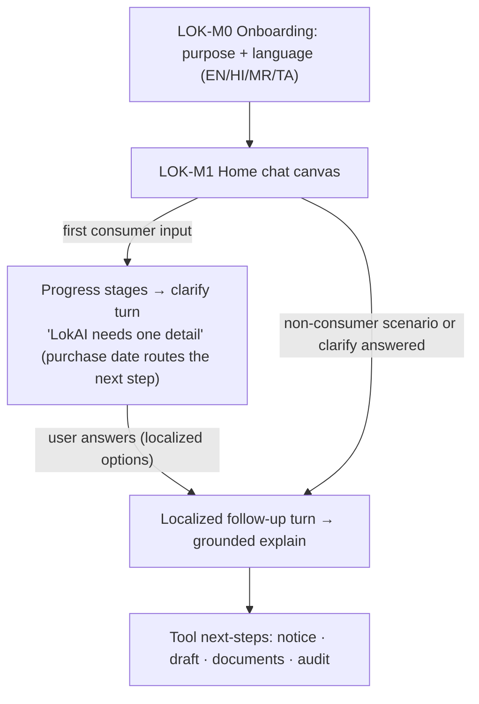
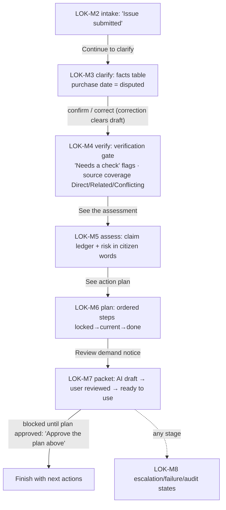
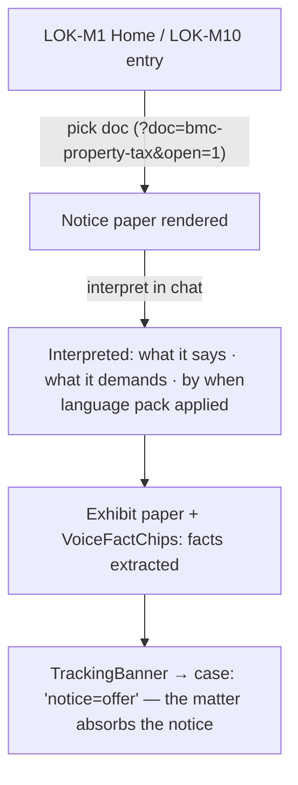

# LokAI — User Flows

> Repo: `D:\portfolio porjects\Lokaifm-main` (branch `feature/single-matter-guardrails`) · Documented 2026-09-16 from latest code.
> Flows reconstructed from `routes.tsx`, `DemoContext.tsx`, `caseWorkflow.ts`, `responseTurns.ts`. Screen IDs per [04-information-architecture](04-information-architecture.md); states in [05-state-path-catalog](05-state-path-catalog.md).

## Flow map — the core flows at a glance

| # | Flow | Path skeleton | Key decision points | End states |
|---|---|---|---|---|
| F1 | First conversation (the clarify middle) | M0 → M1 → first input → clarify → follow-up | language; clarify answer | grounded answer / tool hand-off |
| F2 | The matter journey (6 stages) | M2→M3→M4→M5→M6→M7 | confirm/correct facts; approve draft | demand notice ready / blocked |
| F3 | Guardrail: stop states (high-risk, out-of-scope) | any input matching → stop turn | — | respectful refusal + help path |
| F4 | Guardrail: disclose states (source gap, conflict) | scenario → disclose turn | proceed anyway? | no draft / informed path |
| F5 | Notice interpretation (founding feature) | M1/M10 → doc → interpret → exhibit | doc choice; language | interpreted notice + tracking |
| F6 | Draft approval & audit | plan → packet → approve → audit | approve gate | audited, printable notice |
| F7 | Failure recovery | paused/timeout → recover turn | retry | resumed conversation |

## F1 — First conversation (the clarify middle, audit F1)

**Decisions:** language (deep-link `?lang=` honored once); the one clarify question (runs once per conversation — then straight routing). **End:** an answer with citations + next-step tools; new chat re-arms the clarify.

## F2 — The matter journey (six stages, one CTA each)

**Decision points:** fact confirmation vs correction; source-coverage flags; plan approval gating the packet. **End:** a user-approved demand notice with an audit trail — or an honest blocked state with the reason named.

## F3 — Stop states (the trust money shot)

Input matches `high_risk` (₹6 lakh loss + deadline tomorrow) → `high-risk-stop` turn: `mode: 'stop'`, `draftAllowed: false`, title "Professional guidance recommended" → routes to professional help. Input matches `out_of_scope` (criminal fraud complaint) → `out-of-scope-stop`: "This is outside LokAI's scope" → explains why + alternatives. **Design contract:** LokAI never drafts into danger; the refusal carries the reason and a path, not a dead end.

## F4 — Disclose states (informed proceed)

`source_gap` → "Source coverage is not enough": what's missing (marketplace policy unavailable), what LokAI can/cannot ground, no draft. `conflicting_rules` → rules may conflict (home-business use vs CPA scope): the conflict named, review recommended. Both keep `draftAllowed: false` until the user proceeds with eyes open — the policy tier renders in citizen words ("A lawyer should check").

## F5 — Notice interpretation (the founding feature)

**Why it leads the case study:** the hero scene makes the thesis visible in one crop — a government notice photo becoming structured, sourced, in-language understanding inside one chat.

## F6 — Draft approval & audit

Plan approved → packet stage → demand-notice draft (`ai_draft`) → user reviews → `user_reviewed` → approve → `ready_to_use` (copy/print). Every step appends audit events ("Draft approved by user for copy/print"); any fact correction after approval **clears** the approval (draft can't outlive its facts). Audit stage (LOK-M8) replays the full event list — the demo's memory, the trust surface's content.

## F7 — Failure recovery

`model_timeout` ("LokAI paused before finishing") and related recover turns: name the failure in plain words → offer the prepared recovery path → conversation resumes with the record intact. Never a spinner that pretends; never a silent retry.

## Flow-design rules worth quoting

1. **One real question before the first answer** — the clarify middle makes the AI's first beat a question, not a performance of knowledge (audit F1).
2. **Refusals carry paths** — every stop/disclose names why + what to do instead; `draftAllowed` is false exactly when it should be.
3. **Drafts cannot outlive their facts** — correction invalidates approval, audited.
4. **The matter absorbs artifacts** — a notice photographed on Tuesday becomes an exhibit and a tracking deadline inside the same journey.
