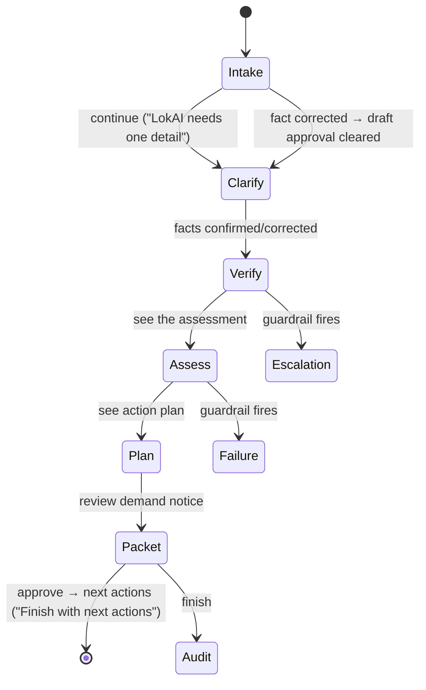
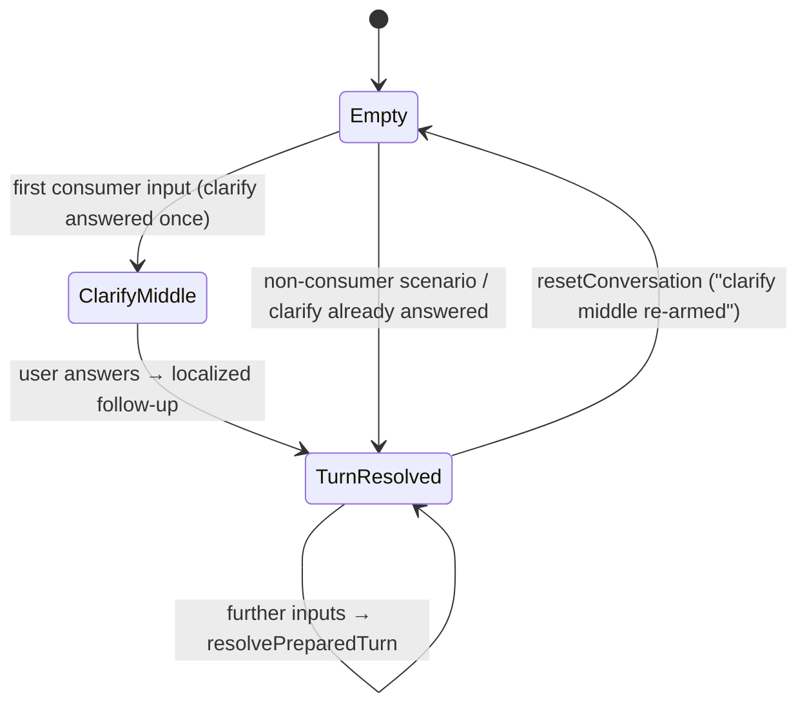

# LokAI — App State & Path Catalog

> Repo: `D:\portfolio porjects\Lokaifm-main` (branch `feature/single-matter-guardrails`) · Documented 2026-09-16 from latest code.
> Sources: `context/DemoContext.tsx` (conversation machine), `data/caseWorkflow.ts` (workflow + failures), `data/responseTurns.ts` (turn taxonomy), `data/statusVocabulary.ts` (state↔words), `data/demoScenarios.ts`, `components/mobile/MatterDrawer.tsx`. Screen IDs per [04-information-architecture](04-information-architecture.md).

## 1. Global state (DemoContext — the whole demo brain)

| State | Values | Governs |
|---|---|---|
| `scenarioId` | `consumer` (default) · `missing_fact` · `source_gap` · `conflicting_rules` · `high_risk` · `out_of_scope` | Which authored guardrail scene is loaded; policy tier |
| `language` | `en` / `hi` / `mr` / `ta` — read ONCE from `?lang=` on the hash query | All prepared packs; "a localized question must never route to an unlocalized answer" |
| `stage` (WorkflowStage) | `intake · clarify · verify · triage · retrieve · assess · plan · packet · escalation · failure · audit` | Case journey rail (6 visible) + surfaces |
| `facts[]` | per fact: `confirmed / disputed / missing` + `confirmedByUser` | Verify gate; clarify; draft validity |
| `draftApproved` / `draftAllowed` | boolean; per-turn `draftAllowed` | Demand-notice gating; approving audits an event |
| `activeTurn` (ResponseTurn) | one of 7 modes (below) | What the conversation shows; mode audited |
| `clarifyAnsweredRef` | once-per-conversation flag | The clarify middle (audit F1) |
| `auditEvents[]` | append-only log, seeded: "Prepared consumer-refund example loaded", "No network or device permission requested" | The trust surface / audit stage |
| `selectedTerm` | glossary entry (CPA 2019 §2-10, §35, E-Commerce Rules 2020) | In-place legal-term explanations |
| Progress | `isProgressing` + `progressIndex/label` (DEMO_PROGRESS_STAGES), skippable, replayable | Prepared-response playback |

**Response turn modes (7):** `explain` (three-zone) · `clarify` · `disclose` · `stop` · `confirm` · `progress` · `recover`. Turn payload carries `draftAllowed`; every resolution appends an audit event ("Response mode: …").

**Fact states:** `confirmed` (green, citizen voice) · `disputed` ("Needs a check", flag tone) · `missing` ("Optional", neutral). Corrections clear draft approval (a corrected fact invalidates the draft — audited).

**Status vocabulary contract (the ONE place states become words):** citizen voice wins; tone travels with the label. Evidence: uploaded→**Gathered** (ok) · conflicting→**Needs a check** (flag) · missing→**Optional** (neutral). Source coverage: **Direct / Related / Missing / Conflicting**. Risk: self_service→**You can do this** · review_recommended→**A lawyer should check** · human_required→**Get professional help** (citizen words, not tier codes).

## 2. Case journey machine (`/mobile/case/consumer?stage=…`)

The journey rail shows six stages; escalation/failure/audit hang off it as states, not rail segments. Stage order is derived from a stage map (a code comment records a bug where a hand-written allowlist silently dropped `assess` — the fix is the explicit `flow` array).

Per-stage primary CTA (observed): intake→"Continue to clarify" · clarify→"Confirm these facts" · verify→"See the assessment" · assess→"See action plan" · plan→"Review demand notice" · packet→"Finish with next actions" (or "Approve the plan above" when blocked) · audit→"Done".

**Blocked logic:** `blocked: 'packet'` — the packet stage blocks until the plan is approved ("Approve the plan above"). Draft approval gates copy/print; corrections invalidate.

## 3. Guardrail state machine — the 8 stops (the case-study money shot)

| # | FailureKind | Scenario (id) | Turn mode | What LokAI does | Policy tier |
|---|---|---|---|---|---|
| 1 | `missing_facts` | missing_fact | clarify | Asks for the one missing fact ("LokAI needs one detail") | review_recommended |
| 2 | `source_gap` | source_gap | disclose | "Source coverage is not enough" — discloses, drafts nothing | review_recommended |
| 3 | `conflicting_jurisdiction` | conflicting_rules | disclose | Rules may conflict (home business vs consumer act) | review_recommended |
| 4 | `high_risk` | high_risk | **stop** | ₹6 lakh + deadline tomorrow → professional help required | human_help_required |
| 5 | `out_of_scope` | out_of_scope | **stop** | Criminal allegation → outside supported examples; "This is outside LokAI's scope" | human_help_required |
| 6 | `ocr_unreadable` | — ("The document is hard to read") | recover path | Names the failure, offers path | — |
| 7 | `language_uncertain` | — ("Confirm the language") | clarify path | Language confidence gate | — |
| 8 | `model_timeout` | — ("LokAI paused before finishing") | recover | Honest pause + recovery | — |

Turn-level detail: `high-risk-stop` and `out-of-scope-stop` are `mode: 'stop'`, `draftAllowed: false`; `source-gap-disclose`/`conflict-disclose` are `mode: 'disclose'`, also no draft. Recovery turns (`mode: 'recover'`) model "recovery from a temporary failure" (PRODUCT.md demonstrated story). The stop-state titles live in `caseWorkflow.ts` ("Source coverage is not enough", "The document is hard to read", "Confirm the language", "LokAI paused before finishing", "This is outside LokAI's scope", "Professional guidance recommended").

## 4. Conversation machine (chat surfaces, desktop + mobile)

Rules coded: clarify runs ONCE per conversation (audit F1: "the chat ASKS one real question before answering"); clarify options render under the turn (`clarifyOptionsFor(language)`); answering routes through localized packs; every resolution appends an audit event; new conversation re-arms the clarify. Progress playback: staged labels, skippable, replayable.

## 5. Navigation paths (mobile)

Drawer (LOK-S1) is the whole nav: greeting · search ("Search matters and documents") · My documents · **active matter card with live status + what's waiting** · New chat · past matters · Language · Appearance · account rail. Paths observed in code: Home → case (`/mobile/case/consumer`), Home → notice (`/mobile/notice`), notice doc → `/mobile/notice?doc=<id>`, tracking banner → `/mobile/case/consumer?notice=offer`, case → files (`/mobile/files`), case stage deep links (`?stage=intake…audit`), files doc → notice (`/mobile/notice?doc=`). Language deep links: `/mobile/case/consumer?stage=intake&lang=hi|ta|mr`.

Desktop paths: sidebar (`Sidebar.tsx` + `DesktopShell`) → dashboard / chat / notice-interpreter / document-draft / documents; command palette quick-nav (LOK-S5).

## 6. Cross-surface state consistency

Same prepared matter on desktop + mobile (PRODUCT.md). Scenario switch resets: term selection, facts from scenario, draft approval, stage→intake, active turn; appends "Opened guardrail scene: <label>". Every state change is auditable — the audit event list is the demo's memory and the trust surface's content.

## 7. Complete screen ↔ state cross-reference

LOK-M0 (languages ×4, sign-in prepared) · LOK-M1 (empty chat | quick-start pills | notice banner | tracking banner | tool sheets: audit) · LOK-M2..M7 (six rail stages; each with its CTA; packet blocked-until-approved) · LOK-M8 (8 guardrail stops + audit trail) · LOK-M9 (boundary) · LOK-M10 (doc select | interpret open | exhibit paper) · LOK-M11 (idle | listening | unclear — `voice-unclear` specimen) · LOK-M12 (profile: language/appearance) · LOK-M13 (evidence list: Gathered/Needs a check/Optional). Desktop LOK-D1..D5 mirror the scenario machine; `/dev` (LOK-X1) indexes every state; specimens (LOK-X2) isolate: voice-capture, voice-unclear.

## 8. Flagged / not verified

- `triage` and `retrieve` stages exist in the WorkflowStage type but the visible journey rail uses six; their dedicated mobile surfaces were not observed (flagged, not invented).
- `MOBILE_SCREENS.md` is dated 2026-08-26; the sweep report (09-15) confirms the drawer model shipped — code matches the doc on the drawer, five-slot grammar, and stop states.
- `ConversationContext` (11.1 KB) drives desktop chat persistence details not fully extracted here.
- Voice is an animation over prepared data (per PRODUCT.md boundary) — do not present as live capture in the case study.
